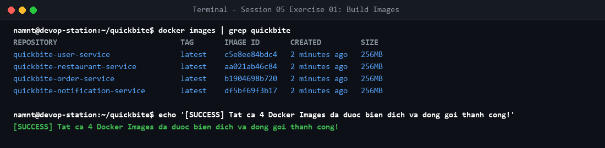

# Bài tập 1: Đóng gói 4 dịch vụ Spring Boot

## 1. Mục tiêu
- Biên soạn cấu trúc Dockerfile tối ưu hóa cho từng microservice.
- Đóng gói đồng thời 4 dịch vụ Spring Boot độc lập thành các Docker Images.

## 2. Dockerfile cấu hình
```dockerfile
FROM eclipse-temurin:17-jre-alpine
WORKDIR /app
COPY build/libs/*.jar app.jar
ENTRYPOINT ["java", "-jar", "app.jar"]
```

## 3. Các image được đóng gói
- `quickbite-user-service:latest`
- `quickbite-restaurant-service:latest`
- `quickbite-order-service:latest`
- `quickbite-notification-service:latest`

## 4. Kết quả kiểm thử
Lệnh kiểm tra: `docker images | grep quickbite`

