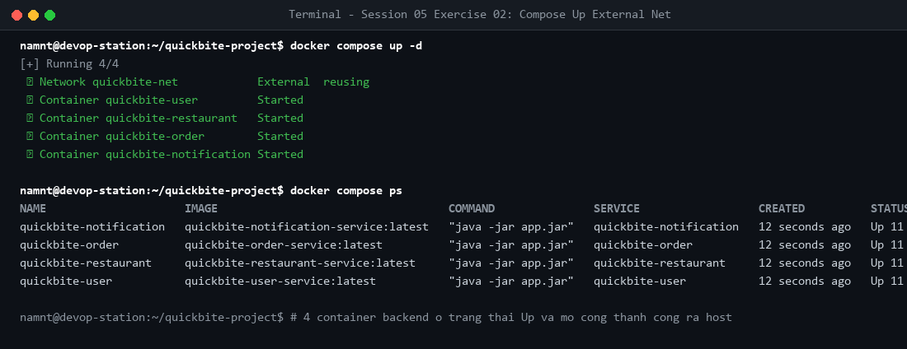

# Bài tập 2: Thiết lập Docker Compose mạng ngoài

## 1. Mục tiêu
- Quản lý cụm 4 microservices bằng Docker Compose.
- Kế thừa mạng ngoài `quickbite-net` (`external: true`) kết nối database PostgreSQL container độc lập.

## 2. Kiểm thử & Kết quả
Khởi chạy hệ thống:
```bash
docker compose up -d
docker compose ps
```

- Cả 4 container đều ở trạng thái `Up`, các cổng 8081, 8082, 8083, 8084 mở thành công ra host.
