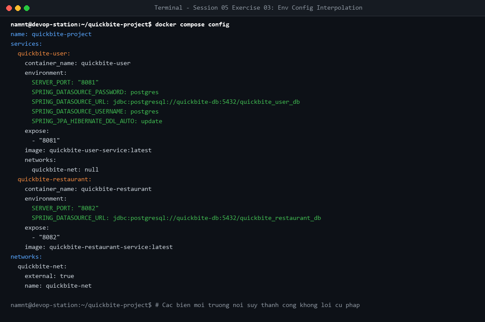

# Bài tập 3: Cấu hình biến môi trường qua tệp .env

## 1. Mục tiêu
- Phân tách cấu hình ra `.env` với prefix độc lập theo từng service (`USER_*`, `RESTAURANT_*`, `ORDER_*`, `NOTIFICATION_*`, `DB_*`).
- Cấu hình an toàn với `.env.example` và `.gitignore`.

## 2. Kiểm thử nội suy biến
Lệnh: `docker compose config`

- Toàn bộ biến `${...}` được nội suy chính xác giá trị thực tế, không có lỗi cú pháp.
