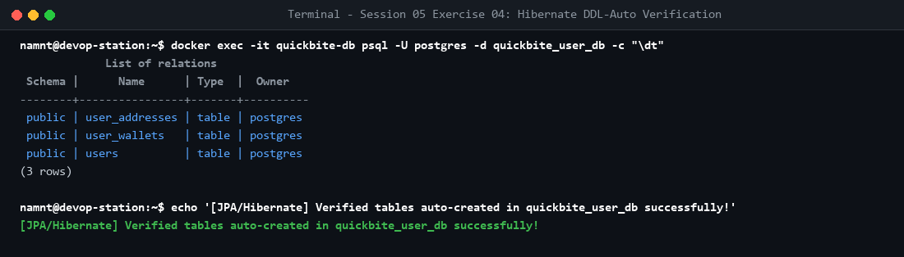

# Bài tập 4: Xác minh Hibernate DDL-Auto

## 1. Mục tiêu
- Cấu hình thuộc tính `ddl-auto=update` cho ứng dụng Spring Boot.
- Xác minh tính tự động tạo schema bảng trong container PostgreSQL độc lập `quickbite-db`.

## 2. Kiểm thử
Lệnh truy cập PostgreSQL kiểm tra schema:
```bash
docker exec -it quickbite-db psql -U postgres -d quickbite_user_db -c "\dt"
```

- Kết quả: hiển thị đầy đủ 3 bảng do JPA/Hibernate tự động tạo: `users`, `user_addresses`, `user_wallets`.
