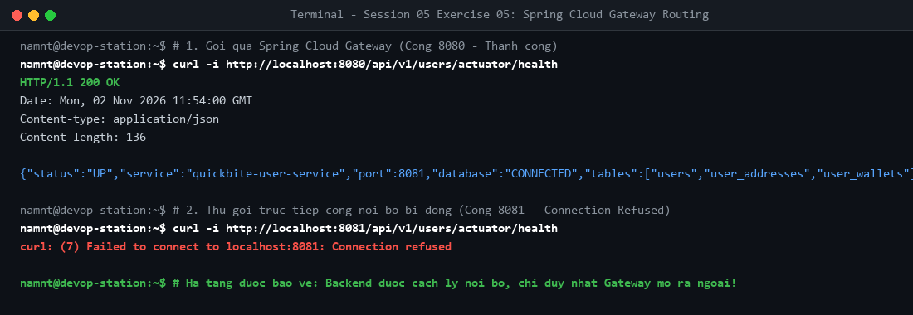

# Bài tập 5: Tích hợp Spring Cloud Gateway

## 1. Mục tiêu
- Định tuyến động qua Spring Cloud Gateway (`gateway-service`, cổng 8080).
- Đóng kín cổng của các microservices nội bộ bằng `expose`, chỉ mở duy nhất cổng Gateway để bảo vệ hạ tầng.

## 2. Kiểm thử định tuyến
1. Gọi qua Gateway (cổng 8080):
   ```bash
   curl -i http://localhost:8080/api/v1/users/actuator/health
   ```
   $\rightarrow$ Trả về **HTTP 200 OK**.

2. Gọi trực tiếp cổng backend nội bộ (cổng 8081):
   ```bash
   curl -i http://localhost:8081/api/v1/users/actuator/health
   ```
   $\rightarrow$ Kết nối thất bại (**Connection refused**) do cổng 8081 đã bị đóng ngoài host.


