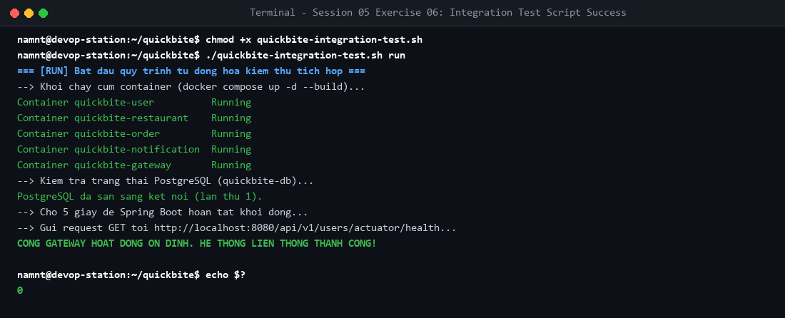

# Bài tập 6: Bash Script vận hành tự động

## 1. Mục tiêu
- Tự động hóa toàn diện quy trình build, start, healthcheck và kiểm thử liên thông microservices.
- Ứng dụng Bash Script xử lý lỗi và dọn dẹp tài nguyên (`docker compose down`).

## 2. Cách chạy
- Khởi chạy và kiểm thử:
  ```bash
  chmod +x quickbite-integration-test.sh
  ./quickbite-integration-test.sh run
  ```
- Dọn dẹp tài nguyên:
  ```bash
  ./quickbite-integration-test.sh clean
  ```

## 3. Kết quả nghiệm thu

- Kịch bản hoàn tất thành công, Gateway liên thông ổn định và in dòng chữ xanh lá `CỔNG GATEWAY HOẠT ĐỘNG ỔN ĐỊNH. HỆ THỐNG LIÊN THÔNG THÀNH CÔNG!`.
